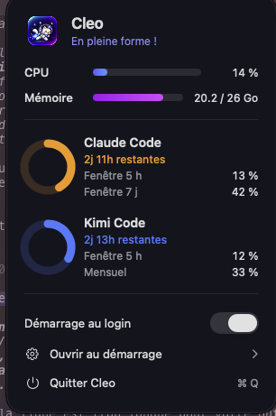

# CLEO // CPU COMPANION

```text
   /\_/\
  ( o.o )     SYSTEM MONITOR // ONLINE
   > ^ <      CPU • MEMORY • AI QUOTAS
```

> *Your CPU is sweating. Cleo is having the time of his life.*

## 01 — THE LORE

Au commencement, il n'y avait qu'une barre de menu. Froide. Grise. Fonctionnelle. Une existence sans relief, sans panache, sans le moindre félin pour juger vos choix techniques.

Puis Cleo est apparu.

Cleo est un chat animé qui fait du parkour dans votre barre de menu. Sa vitesse est directement proportionnelle à l'activité de votre processeur. Vous compilez ? Il accélère. Vous lancez trois environnements Docker, deux builds et un modèle local en même temps ? Il entre en hyperespace.

Votre code plante ? Cleo ne vous juge pas.

Enfin, pas ouvertement.

Mais Cleo ne fait pas que courir. Il surveille aussi vos quotas Claude et Kimi, les représente sous forme d'anneaux et compte les secondes avant leur réinitialisation. Une sorte de tableau de bord personnel, supervisé par un animal qui n'a jamais validé une seule pull request.

Quand le quota tombe à zéro, Cleo s'arrête.

Il vous regarde.

Vous savez tous les deux ce qui vient de se passer.

## 02 — VISUAL FEED

| | |
|:--:|:--:|
|  |  |
| *Surveillance continue. Tolérance nulle.* | *Les anneaux ne mentent jamais.* |

| |
|:--:|
|  |
| *CPU à 32 %, lancement au login activé. Cleo approuve ce niveau d'engagement.* |

## 03 — TELEMETRY

| Signal | Source | Comportement |
|:--|:--|:--|
| CPU | API Mach — `host_processor_info` | Vitesse du chat, lissée pour éviter les sprints déclenchés par un pic de 50 ms |
| MEMORY | `host_statistics64` + pression système | État normal, warning ou critical, mémoire utilisée et swap |
| CLAUDE | Endpoint non officiel `/api/oauth/usage` + jeton du trousseau macOS | Anneaux (barre de menu) et barres (menu) de quota 5 h et 7 j |
| KIMI | `api.kimi.ai/coding/v1/usages` + credentials locaux | Anneaux (barre de menu) et barres (menu) de quota 5 h et mensuel |

### COUNTDOWN PROTOCOL

Les quotas ne se contentent pas d'afficher un pourcentage. Cleo affiche aussi le temps restant avant la prochaine réinitialisation :

```text
CLAUDE  //  5H WINDOW     [███████░░░]  72%
RESET IN: 03h 12m

KIMI    //  MONTHLY       [████░░░░░░]  41%
RESET IN: 02d 14h

CLEO    //  CPU LOAD      [████████░░]  83%
STATUS: RUNNING. OBVIOUSLY.
```

*Exemples illustratifs. Les valeurs réelles dépendent des quotas et des données disponibles.*

## 04 — CAPABILITIES

**ANIMATED COMPANION**

19 frames dessinées à la main. Pas un emoji déguisé en fonctionnalité. Un véritable félin animé dont la vitesse suit la charge CPU.

**LIVE SYSTEM MONITOR**

CPU, mémoire, pression système, swap et quotas IA réunis dans un menu compact. Tout ce qu'il faut savoir, sans transformer votre bureau en cockpit d'avion.

**QUOTA RADAR**

Rafraîchissement automatique des quotas Claude et Kimi, anneaux de progression et compte à rebours avant réinitialisation. Parce que découvrir l'épuisement de son quota en pleine session est une expérience que personne ne devrait rechercher volontairement.

**BOOT SEQUENCE**

Démarrage automatique au login via LaunchAgent, activable depuis le menu. Cleo détecte si une instance tourne déjà. Il y a suffisamment de problèmes en production sans ajouter des clones de chat.

**ZERO DESKTOP FOOTPRINT**

Application macOS native, AppKit + SwiftUI, configurée comme accessoire de barre de menu (`LSUIElement`). Pas d'icône dans le Dock. Pas de fenêtre permanente. Pas de bruit inutile.

Juste Cleo. Et son avis sur votre consommation CPU.

## 05 — INSTALLATION

### Requirements

- macOS récent compatible avec AppKit et SwiftUI.
- Xcode pour compiler la cible `Cleo`.
- Claude Code CLI installé pour la surveillance du quota Claude.
- Kimi Code CLI installé pour la surveillance du quota Kimi.

### Deployment

1. Ouvrez le projet dans Xcode.
2. Sélectionnez la cible `Cleo`.
3. Compilez et lancez l'application.
4. Déplacez `Cleo.app` dans `/Applications` si vous souhaitez l'installer durablement.
5. Activez le démarrage automatique depuis le menu.

Cleo rejoint alors la barre de menu. Le reste relève de sa juridiction.

## 06 — DESIGN PRINCIPLES

**Small footprint. Big attitude.**

Cleo repose sur trois principes :

- **Native first.** Les API macOS quand elles font le travail correctement.
- **Useful telemetry.** Des informations exploitables, pas des chiffres décoratifs.
- **Personality matters.** Un utilitaire système peut être précis sans être ennuyeux.

L'objectif n'est pas de gamifier votre productivité. C'est de rendre la surveillance système suffisamment agréable pour qu'on ait envie de la garder ouverte.

Et d'avoir un chat qui court quand votre Mac travaille trop.

## 07 — FINAL TRANSMISSION

> « Ce jour-là, sans raison particulière, j'ai décidé de courir un peu. Alors j'ai couru jusqu'au bout du thread, et une fois arrivé là, je me suis dit que je pourrais courir jusqu'au bout du process. Et une fois arrivé là, je me suis dit que je pourrais courir à travers tout le scheduler. Et puisque j'étais déjà allé si loin, autant courir à travers le kernel tout entier. C'est ce que j'ai fait, j'ai couru droit à travers le kernel. Puis, sans raison particulière, j'ai continué à courir, j'ai couru droit vers les 100 % de CPU. Et une fois arrivé là-bas, puisque j'étais déjà allé si loin, autant faire demi-tour et recommencer. »
>
> — Cleo, probablement, après ton troisième `npm install` de la journée.

---

*Development incident report: no cats were harmed during development. Several builds were observed behaving suspiciously and subsequently judged.*

**[CHANGELOG](CHANGELOG.md)** // View the system history.
